# SweaterCo Dispatch Copilot

SweaterCo Dispatch Copilot helps factory teams decide which outside workshop should handle each batch of work. It reads requests from a shared chat, checks the order and workshop records, and prepares a table with suggested workshops, delivery estimates and the reasons for each suggestion.

The source repository is [AI-Assisted-Factory-Dispatcher](https://github.com/adityaviolin824/AI-Assisted-Factory-Dispatcher). SweaterCo Dispatch Copilot is the application name.

It is designed for dispatchers who assign the work, operations staff who send requests, and managers who need to understand the plan. Instead of checking every workshop and recalculating its workload by hand, the dispatcher can compare the options, deal with exceptions and make the final decision.

The original messages are kept with the recommendations, so the dispatcher can check where an instruction came from. Missing or conflicting information is flagged for review. Previously saved AI answers can be reused when the same request is processed again.

Learn [how it works](#how-it-works), explore the [architecture](#product-architecture), or [run it locally](#run-locally).

## Why this is useful

- **Less checking by hand.** The dispatcher gets the requests, order details, workshop options and reasons in one table. Python checks restrictions and calculates delivery, cost and queue effects.
- **Less time on routine planning.** The system compares the eight workshops and builds a shared plan. The dispatcher can focus on missing information, exceptions and final choices.
- **Low AI running costs.** Models handle the language tasks. Allocation and structured dispatcher review run in Python without model calls. An identical saved AI request can reuse its answer without another paid call.
- **An easier handover.** Operations staff and managers can read the original messages and recorded reasons instead of relying on one person's memory of the chat.

Recorded per-run model costs, calls and latency are listed in the [evaluation results](#testing-and-recorded-results).

Staff time savings have not yet been measured against a manual dispatcher. Workshop production costs are a separate trade-off: the historical test below achieved faster delivery with higher production cost.

## Core capabilities

The system combines three core capabilities:

1. **LLM-based request interpretation.** Language models read informal chat messages and extract structured tasks, order references and instructions. They also identify follow-ups and propose which request an update belongs to.
2. **Deterministic verification and capacity-aware planning.** Python checks order facts, workshop capabilities and restrictions, then calculates delivery, cost and queue effects. It recommends workshops based on those checks, deadlines and the request's stated preferences.
3. **Human-in-the-loop decision making.** The dispatcher reviews recommendations and exceptions, corrects facts, chooses workshops and approves the final table. Source messages, decisions and reasons are retained so the choices can be traced. Cases that cannot be resolved with the supported actions remain visible.

## How it works

The implemented workflow is:

1. **The team sends requests and corrections in Chat.** When processing starts, the system uses a saved copy of the conversation so later messages do not change the input halfway through a run.
2. **The system identifies the work being requested.** AI reads the messages, extracts the order references and instructions, and connects related follow-up messages. Uncertain connections are left for review.
3. **The requests are checked against the records.** Python checks order quantities, deadlines and workshop restrictions. It then calculates which workshops have the capacity to finish the work, taking their existing queues into account.
4. **The dispatcher receives a proposed dispatch table.** Each suggestion includes a workshop, estimated delivery time, cost and reason. Requests with missing facts, conflicting instructions or no suitable workshop appear under **Needs attention**.
5. **The dispatcher reviews the whole table.** They can correct facts and choose workshops. Their unfinished changes stay on the page until they click **Approve all**.
6. **The final choices are applied together.** The approval flow keeps the dispatcher's workshop choices fixed, schedules the remaining work around them, saves the resulting table and shows what changed. It does not require another approval before saving.
7. **An approved table can be reviewed again.** With **Review again**, the dispatcher adds new choices to the saved ones. Python plans once more and saves a new version, and the earlier version is kept.

The output is a dispatch table for the team to use. It does not yet book work with workshops or update a live factory system.

### How reallocation works

Suppose a dispatcher sends extra work to a workshop and lengthens its queue by two days. Another batch planned there may now miss its deadline. When the dispatcher clicks **Approve all**, Python keeps the dispatcher's own workshop choices fixed and recommends a workshop again for every other ready batch, in deadline order, using the updated queues. A batch whose earlier workshop can no longer finish on time moves to one that can. If none can, it stays under **Needs attention** with the reason.

The saved table shows every row that changed: its old and new outcome, workshop, delivery days and reason. **Review again** repeats this planning on an approved table when the dispatcher adds more choices, and saves a new version.

## Product architecture

This view follows one request from the chat to a saved dispatch table. Read it from top to bottom. The colours show who does the work: teal for the operations team, green for AI, blue for Python and amber for the dispatcher. The only loop, **Review again**, reopens a saved table. The [implementation status](#what-is-available-now) below lists current capabilities.

```mermaid
---
config:
  theme: base
  look: classic
  markdownAutoWrap: false
  themeVariables:
    fontFamily: system-ui, sans-serif
    fontSize: 15px
    primaryTextColor: "#EAF2F5"
    textColor: "#EAF2F5"
    lineColor: "#839BA8"
    clusterBkg: "#111D27"
    clusterBorder: "#334B5A"
    titleColor: "#EAF2F5"
    edgeLabelBackground: "#172631"
  flowchart:
    curve: basis
    wrappingWidth: 320
    nodeSpacing: 30
    rankSpacing: 50
---
flowchart TB
    subgraph PRODUCT["SWEATERCO DISPATCH COPILOT / FROM CHAT TO DISPATCH TABLE"]
        direction TB

        subgraph S1["STEP 1 / OPERATIONS CHAT"]
            direction LR
            SEND["Team sends requests<br/>and corrections"]:::screen
            SNAP["Capture a fixed<br/>snapshot of the chat"]:::screen
            PROCESS["Process the snapshot<br/>(calls paid AI models)"]:::screen
            SEND --> SNAP --> PROCESS
        end

        subgraph S2["STEP 2 / UNDERSTAND AND PLAN"]
            direction LR
            EXTRACT["AI extracts requests<br/>and links follow-ups"]:::ai
            VERIFY["AI reads the latest instructions<br/>Python checks the order facts"]:::logic
            PLAN["Python checks workshop rules,<br/>queues and deadlines,<br/>then ranks the options"]:::logic
            FACTS[("orders.csv<br/>workshops.csv")]:::data
            EXTRACT --> VERIFY --> PLAN
            PLAN -.- FACTS
        end

        subgraph S3["STEP 3 / DISPATCHER REVIEW"]
            direction LR
            READ["Read suggestions, reasons<br/>and Needs attention"]:::human
            CHOOSE["Correct facts, choose workshops,<br/>add or cancel batches<br/>(kept on the page, unsaved)"]:::human
            CHECK["Optional: Check<br/>workshop options<br/>(saves nothing)"]:::human
            APPROVE["Approve all<br/>(every choice, once)"]:::human
            READ --> CHOOSE --> CHECK --> APPROVE
        end

        subgraph S4["STEP 4 / REPLAN AND SAVE"]
            direction LR
            REPLAN["Keep the dispatcher's workshops;<br/>replan other ready work<br/>from the starting queues"]:::logic
            SAVE["Save the dispatch table<br/>and decision history"]:::logic
            CHANGES["Show what changed<br/>and why"]:::logic
            REPLAN --> SAVE --> CHANGES
        end

        S1 -- "fixed snapshot" --> S2
        S2 -- "draft dispatch table" --> S3
        S3 -- "complete choice set" --> S4
        S4 -. "Review again: new choices, new version" .-> S3
    end

    classDef screen fill:#183A49,stroke:#63AFC0,color:#F1F7F9,stroke-width:1.5px
    classDef ai fill:#143D36,stroke:#64B39F,color:#EDFAF5,stroke-width:1.5px
    classDef logic fill:#1C2E40,stroke:#7B9FBC,color:#EFF5FA,stroke-width:1.5px
    classDef human fill:#362C20,stroke:#CBA56D,color:#FFF3E0,stroke-width:1.5px
    classDef data fill:#24342F,stroke:#87AA91,color:#F0F7F1,stroke-width:1.5px
    style PRODUCT fill:#0B141D,stroke:#334B5A,stroke-width:1px
```



Ordinary edits make no request. **Check workshop options** explicitly calculates the full choice set without saving or resuming the graph; **Approve all** calculates and saves immediately, with no mandatory second approval. With no choices, **Approve all** saves the table as shown. A choice set that cannot be applied is refused as a whole, and nothing is saved. **Review again** reopens saved choices; another preview or approval performs the next calculation. The dispatcher can also add a batch for a known order during a paused review or through **Review again**.

Automatic choices enforce workshop rules. Manual destinations may override them, with the consequences recorded. Cancelled requests reserve no queue time; a saved table may retain unresolved rows. The result is a decision table, not workshop bookings or live production updates.

## Backend architecture

This view follows the same journey in code. Each row is one stage, with the API routes, LangGraph nodes and Python functions it uses. Rows 2, 3 and 5 belong to one LangGraph thread: `run_graph` stops at `dispatcher_review`, and `resume_graph` continues it when the dispatcher approves. Only `link_items`, `extract_batch` and `verify_tasks` can call AI models, through the saved-answer cache; every other step is Python and makes no model call. Teal boxes are web pages and API routes, amber boxes are the paused review and its approval, and dotted lines show model calls and input data.

```mermaid
---
config:
  theme: base
  look: classic
  markdownAutoWrap: false
  themeVariables:
    fontFamily: system-ui, sans-serif
    fontSize: 15px
    primaryTextColor: "#EAF2F5"
    textColor: "#EAF2F5"
    lineColor: "#839BA8"
    clusterBkg: "#111D27"
    clusterBorder: "#334B5A"
    titleColor: "#EAF2F5"
    edgeLabelBackground: "#172631"
  flowchart:
    curve: basis
    wrappingWidth: 320
    nodeSpacing: 30
    rankSpacing: 50
---
flowchart TB
    subgraph BACKEND["BACKEND / THE SAME STEPS IN CODE"]
        direction TB

        subgraph B1["1 / CHAT / Next.js Operations page and FastAPI /chat"]
            direction LR
            MSG["POST /chat/messages<br/>save to chat SQLite"]:::screen
            SNAP["POST /chat/snapshots<br/>write a fixed TXT copy"]:::screen
            RUN["POST /chat/snapshots/{snapshot_id}/process<br/>run_graph in the background<br/>(only with ALLOW_PAID_PROCESSING=1)"]:::screen
            MSG --> SNAP --> RUN
        end

        subgraph B2["2 / PROCESS MESSAGES / LangGraph nodes 1-5"]
            direction LR
            START["start_run<br/>new run folder"]:::logic
            LINK["link_items<br/>new task, or AI links<br/>a follow-up to its task"]:::ai
            EXTRACT["extract_batch<br/>AI extracts requests"]:::ai
            VERIFY["verify_tasks<br/>AI assesses instructions;<br/>Python checks the facts"]:::logic
            SAVEOUT["save_outputs<br/>state.json and counts"]:::logic
            MODEL["OpenAI models<br/>via RecordedModel cache"]:::ai
            START --> LINK
            LINK -- "unread" --> EXTRACT
            EXTRACT --> LINK
            LINK -- "all read" --> VERIFY --> SAVEOUT
            LINK -.-> MODEL
            EXTRACT -.-> MODEL
            VERIFY -.-> MODEL
        end

        subgraph B3["3 / PLAN AND PAUSE / LangGraph nodes 6-7"]
            direction LR
            CSV[("orders.csv<br/>workshops.csv")]:::data
            PLAN["plan_allocation<br/>route, check rules, rank;<br/>save plan.json; first review"]:::logic
            PAUSE["dispatcher_review<br/>interrupt(): pause, state kept<br/>in checkpoint SQLite"]:::human
            CSV -.-> PLAN --> PAUSE
        end

        subgraph B4["4 / DISPATCHER REVIEW / Next.js Dispatcher page and FastAPI /reviews"]
            direction LR
            READ["GET /reviews/{thread_id}<br/>read the paused review"]:::screen
            LOCAL["Stage choices in page memory<br/>inspect returned options"]:::screen
            PREVIEW["POST .../preview (optional)<br/>apply_answer outside the graph;<br/>saves nothing"]:::screen
            FINAL["POST .../finalize<br/>submit the whole choice set"]:::screen
            UNCHANGED["POST .../answer<br/>approve_all with no decisions"]:::screen
            READ --> LOCAL
            LOCAL -- "Check options" --> PREVIEW
            PREVIEW -- "Return unsaved draft" --> LOCAL
            LOCAL -- "Approve with choices" --> FINAL
            LOCAL -- "Approve without choices" --> UNCHANGED
        end

        subgraph B5["5 / REPLAN AND SAVE / resume_graph, Python only"]
            direction LR
            APPLY["dispatcher_review resumes<br/>apply_answer checks the set;<br/>a refusal pauses again"]:::human
            BUILD["build_dispatcher_plan<br/>dispatcher's workshops first,<br/>then other ready work by deadline,<br/>from the starting queues"]:::logic
            SAVE["save_review<br/>finalize_review +<br/>save_dispatcher_files"]:::human
            FILES[("Run folder<br/>dispatcher-plan.json<br/>dispatcher-decisions.json<br/>plan-history/")]:::data
            APPLY -- "With choices" --> BUILD --> SAVE --> FILES
            APPLY -- "No choices: approve shown review" --> SAVE
        end

        subgraph B6["6 / REVIEW AGAIN / FastAPI /runs, outside the graph"]
            direction LR
            AGAIN["POST /runs/{run_id}/preview<br/>or /finalize"]:::screen
            SAVED["review_saved_plan<br/>saved decisions + new choices,<br/>then apply_answer"]:::logic
            VERSION["preview saves nothing;<br/>finalize saves a new version,<br/>the earlier one stays in plan-history/"]:::logic
            AGAIN --> SAVED --> VERSION
        end

        B1 -- "snapshot messages" --> B2
        B2 -- "verified tasks" --> B3
        B3 -- "paused review and thread ID" --> B4
        B4 -- "Approve all: resume_graph" --> B5
        B5 -- "Optional: Review again on the saved table" --> B6
    end

    classDef screen fill:#183A49,stroke:#63AFC0,color:#F1F7F9,stroke-width:1.5px
    classDef ai fill:#143D36,stroke:#64B39F,color:#EDFAF5,stroke-width:1.5px
    classDef logic fill:#1C2E40,stroke:#7B9FBC,color:#EFF5FA,stroke-width:1.5px
    classDef human fill:#362C20,stroke:#CBA56D,color:#FFF3E0,stroke-width:1.5px
    classDef data fill:#24342F,stroke:#87AA91,color:#F0F7F1,stroke-width:1.5px
    style BACKEND fill:#0B141D,stroke:#334B5A,stroke-width:1px
```



When the dispatcher has made choices, **Approve all** sends them once to `POST /reviews/{thread_id}/finalize`, which recalculates once and saves through `save_review`. With no choices, the page sends `approve_all` to `POST /reviews/{thread_id}/answer`, which saves the review as shown without recalculating. A refused choice set leaves accepted decisions and plan files unchanged; the graph pauses again with the refusal. Previews and saved-plan **Review again** calculate outside the graph, and previews write nothing.

The shared review functions rebuild from the starting queues. Manual destinations remain fixed, including recorded rule or lateness overrides; ordinary automatic choices enforce eligibility and on-time feasibility. Explicit lateness acceptance is checked against the recalculated estimate. Cancelled requests are excluded before routing and reserve nothing. A saved table can still contain unresolved rows.

The change report detects added/removed rows or changes to outcome, workshop or delivery estimate and includes their before/after reasons. Reason-only changes do not create a change-report row. Neither approval path books workshop work or updates live production queues.

## What is available now

| Part | Status |
|---|---|
| Processing and allocation | The backend reads saved chat files, checks requests and produces workshop recommendations with reasons and queue estimates. |
| Dispatcher review | The backend pauses for the initial review. The dispatcher can submit all choices in one approval request, after which Python recalculates the plan, saves the result and returns a list of changes. **Review again** opens an approved table for new choices and saves a new version. |
| Web interface | Chat and Dispatcher screens exist and call the backend. Chat saves messages, captures a fixed snapshot of the conversation and can send that snapshot through the pipeline to a paused dispatcher review (23 October 2026). Processing calls paid AI models, so the API refuses it unless it was started with `ALLOW_PAID_PROCESSING=1`. Automated browser checks use controlled API responses; the chat bridge also has an offline pipeline integration test using saved model answers. The published evidence does not include a retained live-browser run artifact. |
| Saved AI responses | Identical requests can reuse earlier answers. Changes to the input, model, prompt or settings may require new paid calls. |
| Reallocation | Part of **Approve all**: Python keeps the dispatcher's choices fixed and plans the other ready work again around them, using the updated queues. **Review again** does the same on an approved table. |

## How it is built

AI handles the language in the messages. Python checks the facts and calculates dates, queues, costs and workshop rankings.

| Technology | Role |
|---|---|
| Next.js, React and TypeScript | Build the Chat and Dispatcher screens. |
| FastAPI | Lets the web interface save chat messages and snapshots, start processing, read saved runs, answer paused reviews, preview choices and approve them. |
| LangGraph | Runs the processing steps, repeats message batches and pauses until the dispatcher answers. |
| Python | Applies workshop rules and calculates the dispatch plan. |
| OpenAI models | Extract requests, connect follow-ups and assess the latest instructions for each task. |
| JSON files and SQLite | Store run records, model responses, paused reviews, and the chat's messages and snapshots. |

### Models used for each task

The processing models are configured in [backend/config.toml](backend/config.toml). These are the current settings; each saved run records the settings it actually used.

| Task | Model | Reasoning effort |
|---|---|---|
| Intake: identify requests and follow-ups in the chat | `gpt-5.6-luna` | High |
| Linking: attach a follow-up to the right task | `gpt-5.6-luna` | Medium |
| Verification: assess the latest instructions and their evidence | `gpt-5.6-luna` | Medium |

Python checks the model's proposed facts. Python also calculates dates, workshop eligibility, queues, costs, rankings and allocations. Structured dispatcher review and final approval make no model calls.

The earlier dispatcher experiment in [notebook 06](experiments/notebooks/06-dispatcher-workflow.ipynb) also has optional explanation calls:

| Explanation task | Model | Setting |
|---|---|---|
| Summarize why a workshop was recommended | `gpt-4o-mini` | Temperature 0 |
| Explain why a request needs attention | `gpt-6-luna` | Medium reasoning effort |

These explanation calls belong to the notebook prototype. They are separate from the current API's structured review, and a new explanation request can cost money. The older notebooks retain their historical model settings; [the experiment history](backend/docs/evaluation/PROMPT_TESTING_RESULTS.md) records the comparisons and changes.

### Reusing AI answers and checking decisions

A saved answer is reused only when the processing stage, model, prompt, settings, input and response format match. The answer is still checked, and the dispatch plan is calculated again. Allocation and structured dispatcher review do not make model calls.

Each run keeps its input messages, settings, tasks, model-call records and allocation plan. A separate report script summarizes outcomes, processing time and model cost. With an answer key, it can also score the run. These records help explain why a request was allocated, left unresolved or interpreted incorrectly.

## Testing and recorded results

The allocation rules were tested on 120 historical orders using the supplied simulator. The table below compares the default policy with choosing a random eligible workshop.

| Normal historical replay | Mean days | p90 days | Late | Defective | Cost | Maximum workshop share |
|---|---:|---:|---:|---:|---:|---:|
| Random eligible workshop | 21.5 | 45.6 | 34% | 4% | 111,780 | 23% |
| Default policy: reduce lateness | 8.1 | 13.7 | 2% | 6% | 115,360 | 25% |

The default policy delivered sooner and had fewer late batches in this test, but cost more and had more defective batches. The simulator requires a workshop for every batch, so the evaluation adapter chooses the least-late option when all options are late. The app instead asks the dispatcher to review the case. The [scheduling benchmark report](backend/eval_harness/results/harness_results_2026-10-15.md) includes the other policies and assumptions.

These results measure the scheduling rules, not the accuracy of AI's reading of a conversation. The backend's **170 offline tests passed on 24 October 2026**; later changes have their own checks in the engineering log.

### Chat-to-allocation results

**How we evaluated it:**
1. **Test set.** There are 100 synthetic cases in 149 chat messages. The 85 that should be allocated fit on time in one plan, as an offline check confirms. The other 15 are deliberate exceptions, such as a cancelled order or a suspended workshop. A human-reviewed answer key was frozen on 21 October 2026, before any run.
2. **Rules written first.** Before each paid run, the expected results and the scoring rules were written down and hashed. They were not changed afterwards.
3. **Fresh runs.** Each run processed the whole chat with an empty answer cache and the same models and settings, so every model call was new.
4. **Score before the review** (`backend/make_run_report.py`). Each case is matched to the task the app created from its first message. Under the frozen headline score, a case is **correct** when it is expected to be allocated and receives a recommendation respecting the key's requested and excluded workshops. Provisional recommendations count. Full field agreement, workshop eligibility and timeliness are separate checks; a lost preference can still count as allocated. A case is **missed** when it is expected to be allocated but receives no recommendation. An allocated exception or a broken requested/excluded destination is **unsafe**.
5. **Score after the review** (Test 11 only; `backend/score_dispatcher_review.py`). A simulated dispatcher who knows the answer key reviewed the paused run through the app's HTTP API. It sent one **Approve all** with 23 choices, then **Review again**, which plans the approved table again. Only approved rows count as allocated, with full quantity and the key's requested/excluded destinations checked. The final coverage headline does not require timeliness or every field to match; those are separate details. Split-part lateness/field details currently inspect only the main part.

| | Test 10, run 1 (21 Oct) | Test 10, run 2 (21 Oct) | Test 11 (22 Oct), before review | Test 11, after review |
|---|---:|---:|---:|---:|
| Correct allocations (of 85) | 73 | 80 | **81** | **85** |
| - every field matches the key | 71 | 77 | 78 | 85 |
| Missed (sent to a person) | 12 | 5 | 4 | 0 |
| Exceptions correctly held (of 15) | 14 | 14 | 14 | **15** |
| Unsafe allocations | 1 | 1 | 1 | **0** |
| Chat messages labelled correctly (of 149) | 140 | 145 | 146 | - |
| Follow-ups joined to their task (of 45) | 30 | 35 | 36 | - |
| Model calls, cost, time | 124, $0.0728, 10 min 52 s | 128, $0.0700, 10 min 1 s | 128, $0.0757, 9 min 23 s | no model calls |

**What the results show:**
- The model and Python on their own did best in Test 11 (81 of 85), and the allocator broke no workshop rule in any run.
- With the key-informed review, every expected case was covered and no exception was allocated. All 85 allocations separately matched the compared fields and were reported on time; 26 source rows remained unresolved.
- The "after review" column is the app's ceiling, not a measured human result, because the simulated dispatcher knew the answers.
- The cancelled order (CASE-097) was recommended in all three historical runs; the key-informed review stopped it by changing its intent to a question. Since 24 October, a Python check in verification sends recognized possible cancellation or hold wording for a known order to dispatcher review; it never cancels an order itself. The dispatcher can then select **Cancel this request**, which leaves the request out of the plan with no queue time reserved; an undo brings it back. A free replay of Test 11's saved model answers, with no model calls, held all 15 exceptions with no unsafe allocation and kept 81 of 85 allocations. It is a replay, not a fresh run, so the table above is unchanged.
- Scores varied from 73 to 81 across three identical setups, so a single run's score is indicative only.

The [evaluation guide](evaluation/README.md) explains the test data and scoring. The [Test 10 report](backend/docs/evaluation/GOLDEN_100_RUN_REPORT.md) analyses the failures of the first two runs, and the [Test 11 report](backend/docs/evaluation/END_TO_END_TEST_2026-10-22.md) records the dispatcher's review.

AI custom-created this test set after repeated project experiments. Its questions and dispatch requests span several difficulty levels, designed to resemble real-life situations and target weaknesses in our system. **Three team members divided the work and comprehensively hand-reviewed the entire set, line by line. This review was done by humans, not AI.** Their comments and the documented preference rules were reconciled into the [human-team golden key](backend/docs/evaluation/extended_dispatch_100_human_team_golden.json). The [review record](backend/docs/evaluation/extended_dispatch_100_REVIEW.md) preserves the source workbook, corrections and provenance.

The [feature overview](FEATURES.md) describes the recorded capabilities and evidence. The [backend guide](backend/README.md) covers implementation details.

## Run locally

Use an existing Node.js installation and `uv`. The backend requires Python 3.13.14 and does not download Python automatically. Project dependencies are installed inside the repository.

From the root of `AI-Assisted-Factory-Dispatcher` (the folder containing `backend/` and `frontend/`), start the backend:

```sh
cd backend
uv sync
uv run fastapi dev main.py --host 127.0.0.1 --port 8000
```

In a second terminal, starting from the repository root:

```sh
cd frontend
npm ci --cache ./.npm
npm run dev
```

Open `http://127.0.0.1:3000`. The API documentation is at `http://127.0.0.1:8000/docs`.

Starting these servers does not process a conversation or call an AI model. A fresh clone has no local run output or review checkpoints, so its run list starts empty. The [published results](evaluation/README.md) can be read without running the pipeline. Processing a new conversation is a separate action that can make paid calls; read the [backend guide](backend/README.md) before starting a run.

Selected [experiment notebooks and development notes](experiments/README.md) are included for reading through the earlier work. The original working notebooks, supplied reference documents and saved test snapshots remain local. Some comparison tests require those local files.

## Repository layout

| Location | Contents |
|---|---|
| `evaluation/` | Public guide to the datasets, answer key, recorded results and scoring method. |
| `experiments/` | Earlier notebooks, selected debugging examples and the development timeline. |
| [`frontend/`](frontend/README.md) | Web screens, API calls, local setup and browser tests. |
| `backend/` | Chat processing, allocation, dispatcher review and API code. |
| `backend/config.toml` | Input paths, model settings, batch sizes and dispatch date. |
| `backend/data/` | Orders, workshops, example conversations and the extended test dataset. |
| `backend/data/extended_dispatch_100/` | The 100-case test set: chat, orders and workshops. |
| `backend/docs/evaluation/` | Answer key, team review, run reports, charts and the log of paid test runs. |
| `backend/eval_harness/` | Harness evaluation of the allocation rules, and its results. |
| `backend/output/` | Local runs, cached answers and checkpoints; excluded from Git. |
| `harness/` | The supplied simulator, kept unchanged. |
| `docs/` | System design, project plan, presentation notes and the engineering log. |

API keys belong in the backend environment, never in browser code. Local environment files, application databases, generated run output and backups are excluded from version control. Selected synthetic test data is included. Optional LangSmith tracing sends run data to its external service when enabled.

Current work focuses on integrated journey verification, known correctness gaps and further evaluation. The latest recorded checks, on 24 October 2026 after the cancellation change, passed 170 backend and 66 browser tests. Docker and deployment are left until the end.
