# SweaterCo Dispatch Copilot

SweaterCo Dispatch Copilot helps factory teams decide which outside workshop should handle each batch of work. It reads requests from a shared chat, checks the order and workshop records, and prepares a table with suggested workshops, delivery estimates and the reasons for each suggestion.

The source repository is [AI-Assisted-Factory-Dispatcher](https://github.com/adityaviolin824/AI-Assisted-Factory-Dispatcher). SweaterCo Dispatch Copilot is the application name.

It is designed for dispatchers who assign the work, operations staff who send requests, and managers who need to understand the plan. Instead of checking every workshop and recalculating its workload by hand, the dispatcher can compare the options, deal with exceptions and make the final decision.

The original messages are kept with the recommendations, so the dispatcher can check where an instruction came from. Missing or conflicting information is flagged for review. Previously saved AI answers can be reused when the same request is processed again.

Learn [how it works](#how-it-works), explore the [architecture](#product-architecture), or [run it locally](#run-locally).

## Why this is useful

- **Less checking by hand.** The dispatcher gets the requests, order details, workshop options and reasons in one table. Python checks restrictions and calculates delivery, cost and queue effects.
- **Less time on routine planning.** The system compares the eight workshops and builds a shared plan. The dispatcher can focus on missing information, exceptions and final choices.
- **Low AI running costs.** Models handle the language tasks. Allocation and structured dispatcher review run in Python without model calls. An identical saved AI request can reuse its answer without another paid call.
- **An easier handover.** Operations staff and managers can read the original messages and recorded reasons instead of relying on one person's memory of the chat.

Our total project spending so far is **70 cents** (22 October 2026, reported by the team). Individual test-run costs are listed in the [recorded results](#testing-and-recorded-results).

Staff time savings have not yet been measured against a manual dispatcher. Workshop production costs are a separate trade-off: the historical test below achieved faster delivery with higher production cost.

## How it works

The backend already processes saved conversations and supports final approval. The Chat screen still needs its live API connection.

1. **The team sends requests and corrections in Chat.** When processing starts, the system uses a saved copy of the conversation so later messages do not change the input halfway through a run.
2. **The system identifies the work being requested.** AI reads the messages, extracts the order references and instructions, and connects related follow-up messages. Uncertain connections are left for review.
3. **The requests are checked against the records.** Python checks order quantities, deadlines and workshop restrictions. It then calculates which workshops have the capacity to finish the work, taking their existing queues into account.
4. **The dispatcher receives a proposed dispatch table.** Each suggestion includes a workshop, estimated delivery date, cost and reason. Requests with missing facts, conflicting instructions or no suitable workshop appear under **Needs attention**.
5. **The dispatcher reviews the whole table.** They can correct facts and choose workshops. Their unfinished changes stay on the page until they click **Approve all**.
6. **The final choices are applied together.** The approval flow keeps the dispatcher's workshop choices fixed, schedules the remaining work around them, saves the resulting table and shows what changed. It does not require another approval before saving.

The output is a dispatch table for the team to use. It does not yet book work with workshops or update a live factory system.

### Reallocation: planned

Suppose a dispatcher adds work to a workshop and increases its queue by two days. Another order may now miss its deadline. Reallocation will try to place that order elsewhere, then check the remaining orders using the updated queues. The dispatcher's own workshop choices will stay fixed.

The resulting table will show which orders moved, their previous and new workshops, the delivery estimates and the reasons for the changes. The dispatcher will also have the option to **review again after reallocation**. Reallocation and any subsequent review or approval of that revised table are not implemented yet.

## Product architecture

This planning view shows the workflow from Chat to the dispatch table. The [implementation status](#what-is-available-now) below distinguishes working features from planned ones.

```mermaid
---
config:
  theme: base
  look: classic
  markdownAutoWrap: false
  themeVariables:
    fontFamily: system-ui, sans-serif
    fontSize: 15px
    primaryTextColor: "#EAF2F5"
    textColor: "#EAF2F5"
    lineColor: "#839BA8"
    clusterBkg: "#111D27"
    clusterBorder: "#334B5A"
    titleColor: "#EAF2F5"
    edgeLabelBackground: "#172631"
  flowchart:
    curve: basis
    nodeSpacing: 30
    rankSpacing: 42
---
flowchart TB
    subgraph PRODUCT["SWEATERCO DISPATCH COPILOT"]
        direction TB

        TEAM["Operations chat · Next.js<br/>Requests, questions and corrections"]:::screen
        FACTS[("Order and workshop facts<br/>Quantities, dates, capacity and queue")]:::data

        subgraph PROCESSING["01 / UNDERSTAND AND PLAN · PYTHON + LANGGRAPH"]
            direction LR
            READ["AI reads the messages<br/>and connects follow-ups"]:::ai
            CHECK["Check the facts<br/>Keep missing details visible"]:::logic
            PLAN["Compare workshops<br/>Build a draft dispatch table"]:::logic
            READ --> CHECK --> PLAN
        end

        subgraph DISPATCHER["02 / DISPATCHER REVIEW · NEXT.JS + FASTAPI"]
            direction LR
            VIEW["See suggestions and problems<br/>with reasons and source messages"]:::screen
            CHOOSE["Make all choices on the page<br/>Keep unfinished choices local"]:::pending
            APPROVE["Approve all<br/>Send the complete set once"]:::pending
            VIEW --> CHOOSE --> APPROVE
        end

        subgraph RESULT["03 / SAVE THE DECISION TABLE · PYTHON"]
            direction LR
            APPLY["Keep chosen workshops fixed<br/>Fit other work around them"]:::pending
            SAVE["Save the final table immediately<br/>Show what changed and why"]:::pending
            APPLY --> SAVE
        end

        LATER["Later: reallocate proposed work<br/>Move flexible batches if queues change<br/>Offer Review again after reallocation"]:::pending

        TEAM -. "Chat-to-pipeline connection pending" .-> PROCESSING
        FACTS --> PROCESSING
        PROCESSING --> DISPATCHER
        DISPATCHER -. "One-batch approval connection pending" .-> RESULT
        RESULT -.-> LATER
        LATER -. "If the dispatcher chooses Review again" .-> DISPATCHER
    end

    classDef screen fill:#183A49,stroke:#63AFC0,color:#F1F7F9,stroke-width:1.5px
    classDef ai fill:#143D36,stroke:#64B39F,color:#EDFAF5,stroke-width:1.5px
    classDef logic fill:#1C2E40,stroke:#7B9FBC,color:#EFF5FA,stroke-width:1.5px
    classDef data fill:#24342F,stroke:#87AA91,color:#F0F7F1,stroke-width:1.5px
    classDef pending fill:#362C20,stroke:#CBA56D,color:#FFF3E0,stroke-width:1.5px,stroke-dasharray:5 4
    style PRODUCT fill:#0B141D,stroke:#334B5A,stroke-width:1px
```



## Backend architecture

This planning view shows the processing steps, LangGraph loops, saved records and API connections. The separate reallocation loop and approval of a reallocated table remain pending.

The planned reallocation pass will check each flexible batch in deadline order. If no suitable workshop can finish it on time, the batch will remain in Needs attention rather than being moved repeatedly.

```mermaid
---
config:
  theme: base
  look: classic
  markdownAutoWrap: false
  themeVariables:
    fontFamily: system-ui, sans-serif
    fontSize: 15px
    primaryTextColor: "#EAF2F5"
    textColor: "#EAF2F5"
    lineColor: "#839BA8"
    clusterBkg: "#111D27"
    clusterBorder: "#334B5A"
    titleColor: "#EAF2F5"
    edgeLabelBackground: "#172631"
  flowchart:
    curve: basis
    nodeSpacing: 28
    rankSpacing: 38
---
flowchart TB
    subgraph BACKEND["BACKEND / CURRENT IMPLEMENTATION"]
        direction TB

        INPUT["Saved chat / TXT + config.toml<br/>run_full_pipeline.py starts the run"]:::input
        CSV[("orders.csv + workshops.csv<br/>Trusted batch facts and workshop queues")]:::data

        subgraph GRAPH["LANGGRAPH / RUN THE STEPS AND WAIT FOR THE DISPATCHER"]
            direction TB
            START["start_run<br/>Number messages and open a run record"]:::logic
            LINK["link_items<br/>Create tasks or attach supported follow-ups"]:::ai
            MORE{"Unread messages?"}:::gate
            EXTRACT["extract_batch<br/>Read a small batch and check its evidence"]:::ai
            VERIFY["verify_tasks<br/>AI checks the current request<br/>Python checks dates, quantities and readiness"]:::logic
            OUTPUT["save_outputs<br/>Save messages, task versions and verification"]:::logic
            PLAN["plan_allocation<br/>Route tasks; check and rank workshops<br/>Use earliest deadlines and tentative queues"]:::logic
            REVIEW["dispatcher_review<br/>Pause for corrections or workshop choices<br/>Unresolved cases stay visible"]:::human
            FINAL["save_review<br/>Save approved rows and unresolved cases<br/>as the final dispatch table"]:::human

            START --> LINK --> MORE
            MORE -->|Yes| EXTRACT --> LINK
            MORE -->|No| VERIFY --> OUTPUT --> PLAN --> REVIEW
            REVIEW -->|Edit or refusal: review again| REVIEW
            REVIEW -->|Approve current draft| FINAL
        end

        subgraph LANGUAGE["SHARED AI CALL LAYER"]
            direction TB
            CACHE["RecordedModel + response cache<br/>Reuse an exact saved answer first"]:::data
            MODEL["OpenAI models<br/>Called only when no matching answer exists"]:::ai
            CACHE -->|Cache miss| MODEL
            MODEL -->|Record the answer| CACHE
        end

        subgraph RECORDS["LOCAL RECORDS"]
            RUNS[("Run folder<br/>manifest.json · state.json · calls/<br/>plan.json · dispatcher-plan.json")]:::data
            PAUSE[("SQLite checkpoint<br/>Keep a paused review across restarts")]:::data
        end

        API["FastAPI · current routes<br/>GET /runs · GET /runs/{run_id}<br/>GET /reviews/{thread_id}<br/>POST /reviews/{thread_id}/answer"]:::input

        subgraph REALLOC["PLANNED / ONE-BATCH APPROVAL AND LATER REALLOCATION"]
            direction TB
            FIXED["Start from the original queues<br/>Place dispatcher choices first and keep them fixed"]:::pending
            NEXT{"Another flexible batch<br/>in deadline order?"}:::pending
            OPTIONS["Check workshops against queues so far<br/>Keep or change the previous workshop"]:::pending
            ONTIME{"Eligible on-time option?"}:::pending
            RESERVE["Place the batch at that workshop<br/>Add its production and rework to the queue"]:::pending
            ATTENTION["Keep the batch in Needs attention<br/>Record why it cannot be placed"]:::pending
            CHANGES["Save the table and show every change<br/>Old/new workshop, delivery date and reason"]:::pending
            AGAIN{"Review again selected?"}:::pending
            DONE["Keep the saved table"]:::pending

            FIXED --> NEXT
            NEXT -->|Yes| OPTIONS --> ONTIME
            ONTIME -->|Yes| RESERVE --> NEXT
            ONTIME -->|No| ATTENTION --> NEXT
            NEXT -->|No| CHANGES --> AGAIN
            AGAIN -->|No| DONE
        end

        INPUT --> START
        CSV -. "Order facts" .-> VERIFY
        CSV -. "Eligibility, prices and queues" .-> PLAN
        EXTRACT -. "Interpret wording" .-> CACHE
        LINK -. "Check follow-up links" .-> CACHE
        VERIFY -. "Assess current task" .-> CACHE
        OUTPUT -. "Write" .-> RUNS
        PLAN -. "Write preview" .-> RUNS
        FINAL -. "Write final result" .-> RUNS
        REVIEW -. "Save paused state" .-> PAUSE
        API -. "Read saved plans" .-> RUNS
        API -. "Read or resume review" .-> PAUSE
        REVIEW -. "Future: submit the complete choice set once" .-> FIXED
        FINAL -. "Later: explicit Reallocate action" .-> FIXED
        AGAIN -. "Yes: optional return to dispatcher review" .-> REVIEW
    end

    classDef input fill:#183A49,stroke:#63AFC0,color:#F1F7F9,stroke-width:1.5px
    classDef ai fill:#143D36,stroke:#64B39F,color:#EDFAF5,stroke-width:1.5px
    classDef logic fill:#1C2E40,stroke:#7B9FBC,color:#EFF5FA,stroke-width:1.5px
    classDef data fill:#24342F,stroke:#87AA91,color:#F0F7F1,stroke-width:1.5px
    classDef human fill:#362C20,stroke:#CBA56D,color:#FFF3E0,stroke-width:1.5px
    classDef gate fill:#253341,stroke:#93AABA,color:#F1F7FA,stroke-width:1.5px
    classDef pending fill:#362C20,stroke:#CBA56D,color:#FFF3E0,stroke-width:1.5px,stroke-dasharray:5 4
    style REALLOC fill:#211C16,stroke:#CBA56D,stroke-width:1px,stroke-dasharray:6 5
    style BACKEND fill:#0B141D,stroke:#334B5A,stroke-width:1px
```



## What is available now

| Part | Status |
|---|---|
| Processing and allocation | The backend reads saved chat files, checks requests and produces workshop recommendations with reasons and queue estimates. |
| Dispatcher review | The backend pauses for the initial review. The dispatcher can submit all choices in one approval request, after which Python recalculates the plan, saves the result and returns a list of changes. |
| Web interface | Chat and Dispatcher screens exist. Reading saved runs works. The Chat screen has been tested with simulated responses; its real backend endpoints are not implemented yet. |
| Saved AI responses | Identical requests can reuse earlier answers. Changes to the input, model, prompt or settings may require new paid calls. |
| Reallocation | Redistribution, review again after reallocation, and approval of the revised table are all pending. |

## How it is built

AI handles the language in the messages. Python checks the facts and calculates dates, queues, costs and workshop rankings.

| Technology | Role |
|---|---|
| Next.js, React and TypeScript | Build the Chat and Dispatcher screens. |
| FastAPI | Lets the web interface read saved runs, answer paused reviews and submit final choices for approval. |
| LangGraph | Runs the processing steps, repeats message batches and pauses until the dispatcher answers. |
| Python | Applies workshop rules and calculates the dispatch plan. |
| OpenAI models | Extract requests, connect follow-ups and assess the latest instructions for each task. |
| JSON files and SQLite | Store run records, model responses and paused reviews. The existing chat prototype stores messages separately in SQLite. |

### Models used for each task

The processing models are configured in [backend/config.toml](backend/config.toml). These are the current settings; each saved run records the settings it actually used.

| Task | Model | Reasoning effort |
|---|---|---|
| Intake: identify requests and follow-ups in the chat | `gpt-5.6-luna` | High |
| Linking: attach a follow-up to the right task | `gpt-5.6-luna` | Medium |
| Verification: assess the latest instructions and their evidence | `gpt-5.6-luna` | Medium |

Python checks the model's proposed facts. Python also calculates dates, workshop eligibility, queues, costs, rankings and allocations. Structured dispatcher review and final approval make no model calls.

The earlier dispatcher experiment in [notebook 06](experiments/notebooks/06-dispatcher-workflow.ipynb) also has optional explanation calls:

| Explanation task | Model | Setting |
|---|---|---|
| Summarize why a workshop was recommended | `gpt-4o-mini` | Temperature 0 |
| Explain why a request needs attention | `gpt-6-luna` | Medium reasoning effort |

These explanation calls belong to the notebook prototype. They are separate from the current API's structured review, and a new explanation request can cost money. The older notebooks retain their historical model settings; [the experiment history](backend/docs/evaluation/PROMPT_TESTING_RESULTS.md) records the comparisons and changes.

### Reusing AI answers and checking decisions

A saved answer is reused only when the processing stage, model, prompt, settings, input and response format match. The answer is still checked, and the dispatch plan is calculated again. Allocation and structured dispatcher review do not make model calls.

Each run keeps its input messages, settings, tasks, model-call records and allocation plan. A separate report script summarizes outcomes, processing time and model cost. With an answer key, it can also score the run. These records help explain why a request was allocated, left unresolved or interpreted incorrectly.

## Testing and recorded results

The allocation rules were tested on 120 historical orders using the supplied simulator. The table below compares the default policy with choosing a random eligible workshop.

| Normal historical replay | Mean days | p90 days | Late | Defective | Cost | Maximum workshop share |
|---|---:|---:|---:|---:|---:|---:|
| Random eligible workshop | 21.5 | 45.6 | 34% | 4% | 111,780 | 23% |
| Default policy: reduce lateness | 8.1 | 13.7 | 2% | 6% | 115,360 | 25% |

The default policy delivered sooner and had fewer late batches in this test, but cost more and had more defective batches. The simulator requires a workshop for every batch, so the evaluation adapter chooses the least-late option when all options are late. The app instead asks the dispatcher to review the case. The [scheduling benchmark report](backend/eval_harness/results/harness_results_2026-10-15.md) includes the other policies and assumptions.

These results measure the scheduling rules, not the accuracy of AI's reading of a conversation. The backend's **127 offline tests passed on 21 October 2026**; later changes have their own checks in the engineering log.

### Chat-to-allocation results

The chat-to-allocation pipeline was tested on **100 synthetic cases in 149 messages**, scored before dispatcher review against a human-reviewed answer key. An offline check confirms that 85 cases can be allocated on time together. The other 15 are deliberate exceptions, including a cancelled order and a suspended workshop. The [evaluation guide](evaluation/README.md) explains the test data and scoring rules.

| Recorded run 2, 21 October 2026 | Result |
|---|---|
| Eligible, on-time recommendations | **80 of 85** |
| Recommendations with all allocation fields matching the key | 77 of 85 |
| Recommendations that lost a stated preference | 3 |
| Exceptions correctly held | **14 of 15** |
| Unsafe recommendations | **1** (a cancelled order was recommended) |
| Workshop-rule or deadline violations among recommendations | 0 |
| Follow-ups joined to their task | 35 of 45 |
| Model calls, cost, time | 128 calls, $0.0700, 10 min 1 s |

The cancelled order passed verification and reached allocation. This remains an unsafe result, even though the chosen workshop met the capacity and deadline rules. Missed follow-ups and a Python date check also caused requests to be left unresolved. The [evaluation report](backend/docs/evaluation/GOLDEN_100_RUN_REPORT.md) compares both recorded runs and documents the failures and proposed fixes.

AI custom-created this test set after repeated project experiments. Its questions and dispatch requests span several difficulty levels, designed to resemble real-life situations and target weaknesses in our system. **Three team members divided the work and comprehensively hand-reviewed the entire set, line by line. This review was done by humans, not AI.** Their comments and the owner's final clarifications were reconciled into the [human-team golden key](backend/docs/evaluation/extended_dispatch_100_human_team_golden.json). The [review record](backend/docs/evaluation/extended_dispatch_100_REVIEW.md) preserves the source workbook, corrections and provenance.

The [feature overview](FEATURES.md) describes the recorded capabilities and evidence. The [backend guide](backend/README.md) covers implementation details.

## Run locally

Use an existing Node.js installation and `uv`. The backend requires Python 3.13.14 and does not download Python automatically. Project dependencies are installed inside the repository.

From the root of `AI-Assisted-Factory-Dispatcher` (the folder containing `backend/` and `frontend/`), start the backend:

```sh
cd backend
uv sync
uv run fastapi dev main.py --host 127.0.0.1 --port 8000
```

In a second terminal, starting from the repository root:

```sh
cd frontend
npm ci --cache ./.npm
npm run dev
```

Open `http://127.0.0.1:3000`. The API documentation is at `http://127.0.0.1:8000/docs`.

Starting these servers does not process a conversation or call an AI model. A fresh clone has no local run output or review checkpoints, so its run list starts empty. The [published results](evaluation/README.md) can be read without running the pipeline. Processing a new conversation is a separate action that can make paid calls; read the [backend guide](backend/README.md) before starting a run.

Selected [experiment notebooks and development notes](experiments/README.md) are included for reading through the earlier work. The original working notebooks, supplied reference documents and saved test snapshots remain local. Some comparison tests require those local files.

## Repository layout

| Location | Contents |
|---|---|
| `evaluation/` | Public guide to the datasets, answer key, recorded results and scoring method. |
| `experiments/` | Earlier notebooks, selected debugging examples and the development timeline. |
| `frontend/` | Web screens, API calls and browser tests. |
| `backend/` | Chat processing, allocation, dispatcher review and API code. |
| `backend/config.toml` | Input paths, model settings, batch sizes and dispatch date. |
| `backend/data/` | Orders, workshops, example conversations and the extended test dataset. |
| `backend/data/extended_dispatch_100/` | The 100-case test set: chat, orders and workshops. |
| `backend/docs/evaluation/` | Answer key, team review, run reports, charts and the log of paid test runs. |
| `backend/eval_harness/` | Harness evaluation of the allocation rules, and its results. |
| `backend/output/` | Local runs, cached answers and checkpoints; excluded from Git. |
| `harness/` | The supplied simulator, kept unchanged. |
| `docs/` | System design, project plan, presentation notes and the engineering log. |

API keys belong in the backend environment, never in browser code. Local environment files, application databases, generated run output and backups are excluded from version control. Selected synthetic test data is included. Optional LangSmith tracing sends run data to its external service when enabled.

Current work is focused on connecting the web screens to the API and testing the complete review workflow. Further model evaluation and reallocation will follow. Docker and deployment are left until the end.
