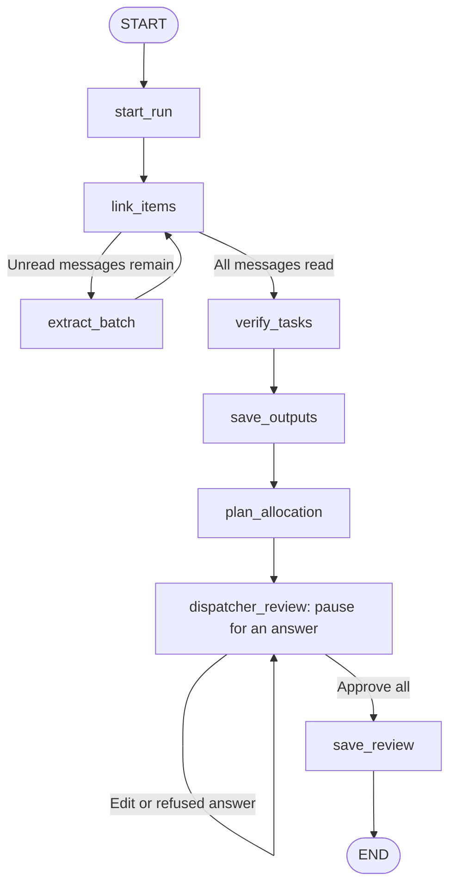

# 05. LangGraph implementation: processing, allocation and dispatcher review

Implementation reference updated: 24 October 2026. The eight-node graph is the initial processing/review workflow; read-only previews and saved-plan Review again reuse its Python rules outside the graph.

The application implements dispatch-table reallocation through **Approve all** and **Review again**. Live workshop assignments, production queue updates and operational transfers remain future work. The [backend guide](../README.md) and [frontend guide](../../frontend/README.md) describe the complete current interface/API contract.

Read [04. Task allocation demo](04-task-allocation-demo.md) first. The implementation explained here is [pipeline_graph.py](../app_full_pipeline/pipeline_graph.py).

## 1. LangGraph responsibilities

Python modules process messages, link requests, verify tasks, calculate workshop choices and apply dispatcher decisions.

LangGraph connects those functions into a workflow. It decides which step runs next, passes the current data between steps and remembers where the workflow paused for the dispatcher.

- A **node** is a Python function that performs a workflow step.
- An **edge** connects one step to the next.
- A **conditional edge** chooses the next step based on the current data.
- **State** is the data passed between the steps.
- A **checkpoint** saves workflow progress so a paused review can continue later.

The LLM interprets language during processing. Python calculates workshop eligibility, delivery, cost, rankings and allocations. LangGraph controls the sequence and the review pause.

## 2. The current graph



There are eight nodes. `after_link` and `after_review` are small routing functions that choose the next node; they are not extra processing stages.

| Node | What happens | Can make model calls? |
|---|---|---|
| `start_run` | Create a run folder and an empty processing record. | No |
| `link_items` | Turn extracted items into tasks or attach supported follow-ups to existing tasks. | Yes, if a needed answer is not cached |
| `extract_batch` | Extract items from the next batch of unread messages. | Yes, if a needed answer is not cached |
| `verify_tasks` | Check each task's current facts and evidence. | Yes, if a needed answer is not cached |
| `save_outputs` | Save processing results and count the outcomes. | No |
| `plan_allocation` | Calculate the initial allocation plan and the first dispatcher review. | No |
| `dispatcher_review` | Pause, receive an answer and apply the dispatcher's decisions. | No |
| `save_review` | Save the displayed review after final approval. | No |

The node functions call the existing module functions. Allocation and decision rules stay in those modules.

## 3. Why extraction and linking form a loop

For a conversation containing several message batches:

1. `start_run` creates an empty record.
2. The first `link_items` finds no extracted items yet.
3. `after_link` sees unread messages and selects `extract_batch`.
4. Extraction produces items for that batch.
5. `link_items` creates tasks or attaches follow-ups from those items.
6. The graph repeats extraction and linking until every message has been read.
7. It then verifies the tasks with all their recorded follow-ups and corrections.

Earlier messages may provide context for extraction. Each target message is owned once, so context is not extracted again just because it appears in another batch.

This sequence lets a later follow-up refer to a task created from an earlier message. An uncertain link stays recorded for review.

## 4. What the state contains

`PipelineState` describes the fields carried by the graph. The important ones are:

| Field | Meaning |
|---|---|
| `messages` | The input chat messages and their IDs. |
| `run_dir` | This run's output folder. |
| `processing` | Extracted items, tasks, verification results and unresolved processing records. |
| `summary` | Processing counts and completeness. |
| `plan` | The initial allocation preview. |
| `decisions` | The dispatcher's accepted edits. |
| `review` | The latest review shown to the dispatcher; the final saved result after approval. |
| `then` | Whether to review again or approve all. |
| `review_error` | Why the last answer was refused, if any. |

Each node returns the fields it updates. For example, the verification node returns an updated `processing` field. LangGraph replaces that field in the state.

The original `plan` and the latest dispatcher `review` are separate, so the original recommendation remains available for comparison.

## 5. How the dispatcher pause works

The `dispatcher_review` node starts with:

```python
answer = interrupt({"review": graph_state["review"], "refused": graph_state["review_error"]})
```

This exposes the saved review to the caller and pauses the workflow. The terminal program can finish while the review stays in the checkpoint database.

When the dispatcher answers, `resume_graph()` uses `Command(resume=answer)` and the same `thread_id`. A thread ID identifies the saved workflow; it is different from the run folder's name.

LangGraph restarts the interrupted node. The supplied answer becomes the result of `interrupt()`, and the node then calls `apply_answer()`.

This is why code before the interrupt only reads the saved review. Final file writes happen in the separate `save_review` node. See the official [interrupt explanation](https://docs.langchain.com/oss/python/langgraph/interrupts).

The runner scripts use `SqliteSaver` with `output/dispatcher-review-checkpoints.sqlite`. The current graph uses `durability="exit"`: graph state is saved when execution stops at a pause, completion or an error, rather than after every processing step.

Processing also saves `state.json`. That file is a processing snapshot; the SQLite checkpoint holds the graph's paused review and workflow progress. A saved processing folder alone is not a paused LangGraph thread. See [LangGraph persistence](https://docs.langchain.com/oss/python/langgraph/persistence).

## 6. A dispatcher answer, step by step

Example only: use a task ID from the actual review.

```json
{
  "decisions": [
    {"decision": "choose_workshop", "task_id": "TASK_ID_FROM_REVIEW", "workshop_id": "W1"}
  ],
  "then": "review_again"
}
```

1. `apply_answer()` checks the answer and applies it to a copy of the decisions.
2. The dispatcher planner rebuilds the draft from the original queues.
3. Dispatcher-selected work is planned first, then the remaining ready tasks around it. Each group uses earliest deadline first.
4. The chosen workshop stays fixed. Lateness, broken automatic rules and overridden processing flags are recorded. Python still requires known order/workshop identities; an unidentifiable batch is refused.
5. The graph returns to `dispatcher_review` and pauses with the updated draft.

A later workshop choice replaces the earlier choice for that task. Rebuilding from the original queues prevents repeated reviews from adding the same work twice.

A refused answer leaves the accepted decisions and review unchanged and returns the reason. Other supported answers correct facts, accept a shown late option, acknowledge warnings or clear a task's edits.

Here, the lower-level `then: review_again` means inspecting a new draft during the paused graph review. The web **Review again** action on a saved plan is also implemented, through `/runs/{run_id}/preview` and `/finalize`, outside the graph.

## 7. Final approval and one-batch reallocation

```json
{"decisions": [], "then": "approve_all"}
```

This empty `approve_all` is the lower-level terminal/API mode: it approves the review already shown. The web **Approve all** action instead submits all pending decisions with `then: finalize` through `POST /reviews/{thread_id}/finalize`. That mode calculates the complete set once, preserves manual destinations, replans flexible work and saves immediately with a change report. It does not require preceding edit requests or another approval.

`after_review` sends approval to `save_review`. That node calls `finalize_review()` and saves:

- `dispatcher-decisions.json`: the dispatcher's recorded decisions.
- `dispatcher-plan.json`: the final review, including any unresolved rows.
- History copies of both files in `plan-history/`.

**Empty `approve_all` preserves the displayed workshops, estimates and queues. Batch `finalize` first calculates the submitted choices, then saves that result.** Allocation rows without unchecked warnings become approved; unresolved rows remain unresolved.

This is final approval of a saved JSON preview. It does not write operational workshop assignments or update live workshop queues.

Notebook 06 remains the earlier prototype with per-row approvals. The current application replaces that per-row interaction with a single batch approval and optional saved-plan re-review.

## 8. What is still incomplete

| Remaining work | What is missing |
|---|---|
| Operational assignments | Persist actual committed batches and their workload. |
| Live queues | Carry assignments and workshop progress into later dispatch decisions. |
| Operational transfers | Move work already accepted by a workshop with transactional release/reservation and remaining-work rules. |
| Clarification reply loop | Return questions to source messages and resume the same request/version. |
| Wider human recovery | Complete handling of unresolved intake/link records and unsupported operations. |
| Authentication and multiple dispatchers | Define identities, permissions and concurrent operational state. |

The graph covers processing, the automatic plan, a persistent initial review and saving the final table. FastAPI/Next.js connect that flow to Chat and Dispatcher. Preview and saved-plan Review again call the same rules outside the graph; live operational assignments remain outside this workflow.

## 9. Where to look and how to check it

- [pipeline_graph.py](../app_full_pipeline/pipeline_graph.py): the state, nodes, edges, pause and resume functions.
- [dispatcher_plan.py](../dispatcher_review/dispatcher_plan.py): dispatcher recalculation and final labeling.
- [dispatcher_decisions.py](../dispatcher_review/dispatcher_decisions.py): answer validation and application.
- [run_full_pipeline.py](../run_full_pipeline.py): start processing and stop at the first review. Cache misses can make paid calls; do not run it without authorization.
- [resume_dispatcher_review.py](../resume_dispatcher_review.py): show or answer an existing paused review, with no model calls.
- [test_pipeline_graph.py](../tests/test_pipeline_graph.py): offline workflow, review, queue and SQLite pause/resume checks.

Run the graph tests from `backend/`, with no paid model calls:

```bash
uv run python -m unittest discover -s tests -p test_pipeline_graph.py -v
```

A LangGraph routing function chooses the next workflow step. FastAPI's `APIRouter` groups HTTP endpoints. The current FastAPI routes call these graph functions for initial reviews and the same planning functions directly for preview and saved-plan re-review.
