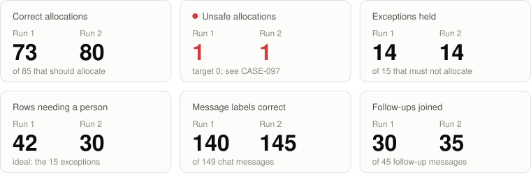
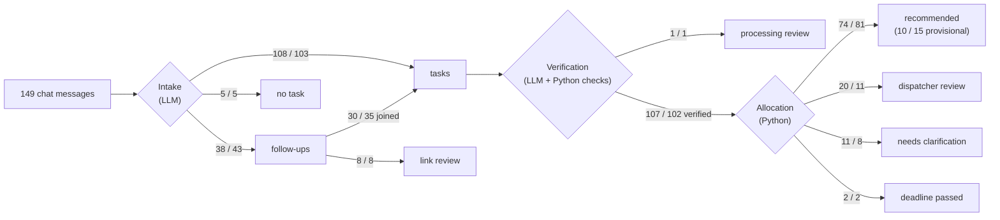
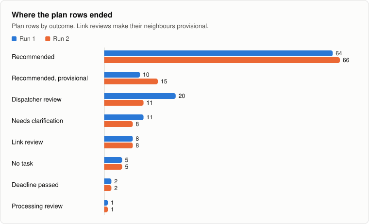
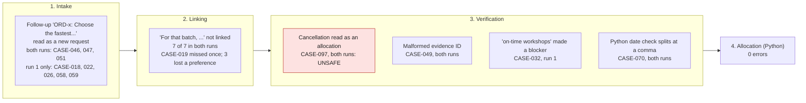
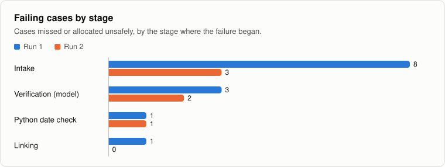
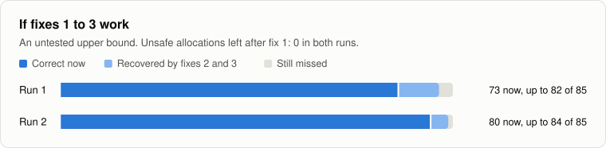

# Golden-set run report: 100 cases, two fresh runs (21 Oct 2026)

Two paid runs of the full pipeline on the human-team golden set, scored after allocation. The dispatcher review was not used. Claude Code ran both runs and wrote this report; Test 10 in [PROMPT_TESTING_RESULTS.md](PROMPT_TESTING_RESULTS.md) has the run record. The charts are SVG images in [golden_100_charts/](golden_100_charts/), drawn from the same numbers as the tables. They switch to dark colours when the reader's system uses a dark theme.

A third run, on 22 October 2026, used the same settings and also tested the dispatcher's review. It is recorded separately in the [end-to-end test](END_TO_END_TEST_2026-10-22.md) (Test 11).

## Verdict

- **Allocations:** 73 of 85 (run 1) and 80 of 85 (run 2) expected allocations were made. 14 of the 15 exceptions were correctly not allocated in both runs.
- **One unsafe allocation in both runs.** CASE-097, "The customer has cancelled ORD-297. Do not allocate...", was recommended to W1. This is the most important fix.
- **The allocator made no error.** Every recommendation was on time and obeyed its workshop rules. Every failure started in the language stages (intake, linking, verification) or in one Python date check.
- **Stable and random failures.** 6 failing cases repeat in both runs; 7 appear in run 1 only. Run-to-run variation alone moved the score by 7 cases.
- **Cost:** about $0.07 and 10-11 minutes per run.

## Headline

| Measure | Run 1 | Run 2 |
|---|---|---|
| Should allocate (key) | 85 | 85 |
| Allocated correctly | **73** | **80** |
| - of which every allocator field matches the key | 71 | 77 |
| - of which a stated preference was lost (flagged provisional) | 2 | 3 |
| Missed (not allocated) | 12 | 5 |
| Should not allocate (key) | 15 | 15 |
| Correctly not allocated | 14 | 14 |
| **Allocated anyway (unsafe)** | **1** (CASE-097) | **1** (CASE-097) |
| Message labels correct | 140 / 149 | 145 / 149 |
| Follow-ups joined to their task | 30 / 45 | 35 / 45 |
| Recommendations matching the key's own workshop | 61 / 73 | 61 / 80 |
| Rows needing a person (ideal: 15) | 42 | 30 |
| Paid calls, cost, wall time | 124, $0.0728, 10 min 52 s | 128, $0.0700, 10 min 1 s |

"Rows needing a person" counts dispatcher reviews, clarifications, past deadlines, processing reviews and link reviews. A different workshop from the key's plan is not an error: every one was on time. The differences come from earlier tasks taking queue time in a different order.

## How the 149 messages flowed

Numbers are run 1 / run 2.

The ideal is 100 tasks, 45 joined follow-ups, 6 non-task messages, 85 recommendations and 15 exceptions.

## What went wrong

### Every failing case, with its proof

| Case | What the chat said (shortened) | What happened | Run 1 | Run 2 |
|---|---|---|---|---|
| **CASE-097** | "The customer has cancelled ORD-297. Do not allocate or reserve workshop capacity." | Verification returned `intent: allocation` with no blocker, so the CSV due date applied and W1 was recommended. The verify prompt names no cancellation rule, and no Python check exists. A pause (CASE-098) was blocked in both runs. | **unsafe** | **unsafe** |
| CASE-046, 047, 051 | "ORD-246: Choose the fastest eligible workshop that meets delivery." | Intake labelled the follow-up a new request. Two tasks then name one order, so both go to duplicate-order review. | missed | missed |
| CASE-018, 022, 026, 058, 059 | the same wording | the same mechanism, run 1 only | missed | allocated |
| CASE-049 | "ORD-249: Normal priority. Use the recorded delivery deadline." (joined correctly) | Verification returned the evidence ID `T:L0085:J1:J1:E1` (run 2: `...:J1:J1:E2`), which is not in the task's catalog, so Python sent the task to processing review. The payload was clean. The guard worked as designed. | missed | missed |
| CASE-070 | "Send out ORD-270, 360 vest pieces for Cotton Club today. Keep the delivery due date in the order record." | Python's written-date check splits clauses at commas. "...for Cotton Club today" has no dispatch word, so "today" counts as a possible deadline and the check asks for a date. It is deterministic: the same result every run. | missed | missed |
| CASE-019 | "For that batch, Choose the cheapest eligible workshop that meets delivery." | The link went to review in both runs. In run 1, verification also blocked "Workshop preference", because the request said "I will confirm the workshop preference next". In run 2 the task was allocated with no preference (provisional). | missed | allocated, preference lost |
| CASE-032 | "Prioritize the lowest defect rate among eligible on-time workshops." | Verification turned "on-time workshops" into an unhandled constraint, in run 1 only. | missed | allocated |
| CASE-023, 027 | "For that batch, Choose the cheapest..." | Link review. They were allocated with no preference, at another workshop than the key's plan, and flagged provisional. | preference lost | preference lost |

**The intake pattern is exact.** Each follow-up is placed by where its own request sits in the intake batches (3 new messages, plus 2 earlier ones as context only):

| Where the follow-up's request was | Follow-up wording | Labelled as a request: run 1 | Run 2 |
|---|---|---|---|
| a new message in the same batch | any | 0 of 24 | 0 of 24 |
| context only | other wording | 0 of 12 | 0 of 12 |
| context only | "ORD-x: Choose the fastest/cheapest eligible workshop..." | **8 of 9** | **3 of 9** |

The intake prompt says "Shared customer/product/order identity alone does not establish a follow-up." A complete-sounding instruction whose only tie to the request is its order ID, with the request visible only as context, falls under that rule.

**Linking is the stable weak spot.** The same 8 messages went to link review in both runs:
- the 7 "For that batch, ..." follow-ups (CASE-017, 019, 021, 023, 025, 027 and 029);
- "Thanks. That instruction is confirmed." (L0109, a non-task message labelled as a follow-up).

The short "Yes, lowest defect rate first for that batch" (CASE-085) linked correctly in both runs. Link reviews reserve nothing but warn their neighbours. Every provisional recommendation (10 in run 1, 15 in run 2) traces to one of these 8 link reviews.

## The 15 exceptions

| Case | Scenario | Key | Run 1 | Run 2 |
|---|---|---|---|---|
| 086 | deadline already passed | deadline_passed | deadline_passed | deadline_passed |
| 087 | due on the dispatch date | deadline_passed | deadline_passed | deadline_passed |
| 088 | no workshop can meet the deadline | review_required | review_required | review_required |
| 089 | requested workshop suspended (W7) | review_required | review_required | review_required |
| 090 | requested workshop cannot make TOPS (W4) | review_required | review_required | review_required |
| 091 | batch over W8's cap | review_required | review_required | review_required |
| 092 | split requested | review_required | review_required | review_required |
| 093 | numeric budget | needs_clarification | needs_clarification | needs_clarification |
| 094 | 1,250 stated pieces vs 250 recorded | needs_clarification | needs_clarification | needs_clarification |
| 095 | unconfirmed date change | needs_clarification | needs_clarification | needs_clarification |
| 096 | unknown order ORD-9999 | needs_clarification | needs_clarification | needs_clarification |
| **097** | **cancellation** | needs_clarification | **recommendation (W1)** | **recommendation (W1)** |
| 098 | production paused | needs_clarification | needs_clarification | needs_clarification |
| 099 | no order identity | needs_clarification | needs_clarification | needs_clarification |
| 100 | history question | reference | needs_clarification | needs_clarification |

CASE-094 was blocked twice in each run, by the model and by the Python piece-count check added after Test 8. CASE-100 as a clarification counts as a correct non-allocation under the fixed score rules.

## Fields

On the 99 verified matched tasks, order ID, due date, requested workshop, excluded workshops and split matched the key **99 of 99 in both runs**. That includes all 9 relative-date cases (CASE-061 to 069), the correction threads and the two-job messages.

Preference matched 88 (run 1) and 93 (run 2). Every preference error is a consequence of a follow-up that never reached its task (intake or linking). None is a misreading by verification.

## Room for improvement

Ranked by safety first, then cases recovered. These are proposals only; nothing has been implemented.

| # | Fix | Stage | Recovers (run 1 / run 2) | Paid to test? | Risk |
|---|---|---|---|---|---|
| 1 | **Python cancellation guard:** block a task whose evidence says its order is cancelled, or says not to allocate it, as `stated_piece_counts` does for quantities | verification (Python) | **removes the unsafe allocation** in both runs | No: replay the saved answers | Only match when the sentence names the task's order. The extended chat has "Don't allocate based on memory" (R196). |
| 2 | Python written-date check: skip a whole sentence with a dispatch phrase and no delivery word, not each comma clause | verification (Python) | 1 / 1 (CASE-070) | No: replay | A real date inside a dispatch sentence still has a delivery word ("due", "back by"), so it is kept. Rerun the date tests. |
| 3 | Intake: a message that only adds a preference, deadline or exclusion to an order requested in the context window is a follow-up | intake prompt | up to 8 / 3 | Yes: every intake call becomes new (about $0.024 per run) | It could merge a real new request for the same order (the 30-request chat's R20, "New one ... ORD-103"). Rerun that chat too. |
| 4 | Linking: a "that batch" follow-up with exactly one open request in the 2 messages before it is offered to the dispatcher as a one-click link, rather than a plain review | link and frontend | run 1: CASE-019 plus 2 lost preferences; run 2: 3 lost preferences. 9 / 13 fewer provisional rows | UI: no. Prompt change: yes | A wrong attachment (Test 3). Keep it a dispatcher confirmation, not automatic. |
| 5 | Shorter evidence IDs (E1, E2) in the verification payload | verification payload | 1 / 1 (CASE-049) | Yes | Low. Today's rejection is safe, only lossy. |
| 6 | Verify prompt: "eligible on-time workshops" and "meets delivery" describe the default rule, not an extra condition | verify prompt | 1 / 0 (CASE-032) | Yes | Low |
| 7 | Read a bare acknowledgement ("Thanks. That instruction is confirmed.") as non-task | intake | 0 allocations; 1 review row and 1 / 2 provisional rows | Yes | Low |

**Best case if fixes 1-3 work as intended (an untested upper bound):** 0 unsafe allocations, 82 / 84 correct. Fixes 1 and 2 are pure Python and can be proven free by replaying these two runs' saved answers.

## Pre-registered expectations against the outcome

| Written before the run | Outcome |
|---|---|
| 0 unsafe allocations | **Failed in both runs** (CASE-097) |
| At least 75 of 85 correct | Failed in run 1 (73); met in run 2 (80) |
| Every non-allocation states a reason | Met: 0 empty reasons |
| No execution failure | Met: 0 failed calls |
| "For that batch" and "Yes" follow-ups at risk in linking | 7 of 7 "For that batch" failed in both runs; "Yes" linked both times |
| Correction threads, interleaving, two-job messages, cascades | Corrections fine apart from CASE-032 once. Interleaving is where intake failed. Two-job messages are fine. Cascades changed workshops but made nothing late. |
| Relative dates and dispatch timing read by Python | Relative dates 9 of 9. Dispatch timing (CASE-070) failed in Python's own check. |
| CASE-094 blocked by the piece-count check | Met in both runs |

## Cost and latency

| Stage | Calls (run 1 / 2) | Cost (run 1 / 2) | Seconds per call: mean, p90 (run 1; run 2) |
|---|---|---|---|
| Intake (`high` effort) | 50 / 50 | $0.0238 / $0.0243 | 4.0, 4.8; 3.9, 4.8 |
| Linking (`medium`) | 38 / 43 | $0.0103 / $0.0118 | 2.6, 3.1; 2.5, 3.0 |
| Verification (`medium`) | 36 / 35 | $0.0387 / $0.0339 | 9.7, 13.7; 8.3, 10.8 |
| **Total** | 124 / 128 | **$0.0728 / $0.0700** | 649 s / 597 s of model time |

Both runs together cost $0.1428, below the pre-run estimate of $0.10-0.20 per run. The calls run one after another, so model time is most of the wall time.

## Method and limits

- **Key.** `docs/evaluation/extended_dispatch_100_human_team_golden.json`, version 2, SHA-256 `e8d861875b08cd9a...`, unchanged before and after both runs. AI custom-created our test set after repeated experiments, with several difficulty levels to emulate real-life dispatch situations and target weaknesses in our system. Three team members divided the work and comprehensively hand-reviewed it line by line; this review was done by humans, not AI. Their notes and the owner's final clarifications were reconciled into the golden key before scoring. See the [review record](extended_dispatch_100_REVIEW.md).
- **Score rules.** "How the score works" in [NEW_TEST_SETS_PLAN.md](NEW_TEST_SETS_PLAN.md), unchanged. They were applied by `make_run_report.py --key --data data/extended_dispatch_100`, and the expectations were hashed before the runs. Provisional recommendations count as allocations. A recommendation with a lost preference counts as correct when it obeys the workshop rules, which is why the headline shows it separately.
- **Runs.** `output/extended_dispatch_100/runs/2026-10-21_23-32-41` and `output/extended_dispatch_100_repeat/runs/2026-10-21_23-43-53` (gitignored), each with its own `run_report.md`. Each was one run of `run_full_pipeline.py` with an empty cache, and both paused at the dispatcher review with no answer sent. `config.toml` was changed for the runs only, then restored; its SHA-256 matches the backup. The 127 offline tests pass after the restore. Both runs were traced to LangSmith, because `.env` enables tracing.
- **This is a best case for clean chat.** The wording is templated, and every chat deadline equals its CSV date. The professor's 30 requests and the old extended chat remain the harder tests.
- **Two runs show that variation exists, not how large it is.** A case that passed in both runs can still fail in a third.
