# End-to-end project architecture

Updated on 15 October 2026. This explains the intended Track 2 product, distinguishes the current modules from planned application behavior, and retains the earlier notebook architecture as history. It does not implement a new dispatch policy or application feature.

For direct insertion into PowerPoint, use the [landscape 8K presentation PNG](architecture/project-architecture-presentation-8k.png) (7680 × 4320 pixels, 16:9, white background). It condenses the same architecture into six readable stages. The [full-detail PNG](architecture/project-architecture-full-detail-4x.png) preserves the complete overview at four times its rendered resolution. The landscape image's editable vector source is [project-architecture-presentation.svg](architecture/project-architecture-presentation.svg).

Open [the diagram viewer](architecture/project-architecture.html) for all six rendered diagrams, readable zoom, SVG export and the Mermaid source for each view. The viewer is self-contained and works offline. Editable `.mmd` sources and exported `.svg` diagrams are in [architecture/](architecture/).

## Reading the diagrams

| Colour | Responsibility |
|---|---|
| Blue | Operations users, chat interfaces, dispatcher console and visible outcomes. |
| Purple | LangGraph workflow nodes, shared state and routing; lighter purple identifies language-model interpretation. |
| Teal | Deterministic checks, calculations, tools, allocation and evaluation. |
| Amber | Human dispatcher decisions, clarification and review. |
| Grey | Trusted data, stored evidence, previews, workflow records and operational state. |

`CURRENT` identifies existing prototype behavior. `PLANNED` and dashed node borders identify future application behavior. Some nodes explicitly contain both current and planned responsibilities. Dashed arrows mean a supporting read/write, evidence dependency or future integration; arrow labels explain which. A dashed arrow alone is not an implementation-status claim.

The overview shows component responsibilities. The intake and allocation views expand their internal behavior. The current-prototype view gives the module graph's six nodes and one conditional router, including the initial `link_items` pass before extraction. A semantic processing step in a detail view is not necessarily a separate LangGraph node.

## 1. Whole-product overview

The intended journey is multiple users posting requests and corrections into operations channels, one intake pipeline preserving their original evidence, checked current tasks entering a deterministic allocator, and one dispatcher reviewing a stored preview. After feedback, the workflow either clarifies, recalculates, rejects, or commits under the agreed approval policy. Recorded outcomes return to the dispatcher view and originating channel.

The [Factory Primer](../reference-documents/Factory_Primer.md) is the business test for this design: category compatibility establishes whether a workshop **can make it**; capacity and current queues establish whether it **can take it now**; status, caps and request restrictions establish whether it **is allowed to**. The dispatcher sees the evidence for all three rather than only a workshop name.

[Mermaid source](architecture/01-end-to-end.mmd) · [SVG diagram](architecture/01-end-to-end.svg)

## 2. Intake, task identity and validation

One message can contain multiple independent jobs; a correction can extend an existing task. The model proposes interpretations and supporting source quotations. Python validates message ownership, source evidence, identities, trusted lookups and current versions. A task is ready only when the required facts and instructions are sufficiently checked.

A linked correction preserves the original evidence, increases the task version and invalidates the earlier verification. Live integration must also invalidate its earlier preview. An unresolved follow-up remains in review; potentially affected original tasks continue through verification and allocation. Their plan summaries become provisional and `review_warnings` records the possible relationship. The unresolved instruction is not silently applied. Reviews are expected interpretation outcomes; an API, file or programming error stops the batch at the failure, leaving the last saved progress available.

The current batch workflow reads and links all messages before verification. Completion means every input is accounted for, not that every request was allocated. The graph passes the same-run state directly into allocation without a separate handoff file or completion gate. An incomplete state can produce a labelled partial preview with missing outcomes listed. A thrown processing exception still stops the full graph before allocation; the standalone allocator can inspect an explicitly chosen saved checkpoint. Asking a user and waiting for a reply is planned.

[Mermaid source](architecture/02-intake-and-validation.mmd) · [SVG diagram](architecture/02-intake-and-validation.svg)

## 3. Allocation and queue behavior

The graph passes its current processing state into the allocation module; the standalone allocator loads an explicitly named run folder. Allocation plans earliest deadline first; equal deadlines retain source order. It routes unready, unsupported and information tasks out before workshop selection. Duplicate allocation requests for one order need review rather than assumed extra batch authority.

Python filters status, capability, batch caps, requested destinations and exclusions, then computes production, expected rework, queue delay, pickup lead, completion feasibility and cost. The normal preview requires an allowed on-time workshop before ranking by the request's preference. An explicit requested workshop is not silently replaced. Informational alternatives in a review do not reserve work.

Each recommendation, including a provisional recommendation, updates only a copy of the starting production queues; later tasks in that preview see those tentative additions. Review items reserve nothing. Warnings are added after planning without changing workshop selection. The detailed decision status remains unchanged: consumers must also read `review_warnings` and the provisional `summary_rows` labels. A rerun starts from the controlled snapshot again. An actual committed assignment requires the separate planned workflow below.

This diagram records the current modules' EDD behavior. The three archived [modularization plans](../backend/docs/legacy/) preserve earlier decisions and verification; they are not current implementation instructions. Source CSVs are assumed unchanged during a run. Future live calendar/status handling and deadline reconciliation remain separate decisions.

[Mermaid source](architecture/03-deterministic-allocation.mmd) · [SVG diagram](architecture/03-deterministic-allocation.svg)

## 4. Dispatcher feedback, approval and reallocation

This entire live interaction is planned. The diagram illustrates the explicit-confirmation path requested for the product explanation; it does not settle the still-open automatic-versus-human initial-assignment policy.

| Feedback | Next behavior |
|---|---|
| Ask why a decision was made | Explain the stored facts, rejection reasons and computed comparisons. Reuse the recorded decision by default. |
| Supply a missing fact or correction | Attach evidence to the same task, increase its version, invalidate old checks/preview, and verify again. |
| Ask what happens with a different deadline or workshop | Call deterministic tools and produce a new preview. A what-if answer is not assignment approval. |
| Select a feasible alternative | Validate the chosen option against current facts and hard rules; a lower-ranked eligible workshop may be selected. |
| Confirm | Recheck task, assignment and queue versions, then commit assignment/reservation/history atomically. A stale preview returns to recalculation and review. |
| Reject or cancel | Record the outcome and retain any existing valid assignment. |
| Request a move after work has started | Resolve the remaining-work/recall/rework policy first; do not erase performed work or assume the entire original quantity can move. |

On a valid move, the transaction releases only movable old work and reserves the replacement while retaining other batches' reservations. A failed write leaves the previous assignment intact. Repeated operations and choosing the existing workshop must not create duplicate reservations. Production at the external workshop and physical pickup/delivery remain outside this application's implementation boundary; the app records the assignment instruction and operational evidence it is given.

[Mermaid source](architecture/04-dispatcher-feedback.mmd) · [SVG diagram](architecture/04-dispatcher-feedback.svg)

## 5. What exists today: chat to batch graph

Multiple browser sessions can use the existing shared Streamlit room. Submitted messages persist in SQLite; unsent drafts belong to a browser session. An explicit export captures a full-conversation TXT snapshot and companion manifest. Original multiline messages remain recorded, while the TXT uses one physical line per message. A new snapshot requires a fresh processing run, not a resume pretending the old input is unchanged.

The transfer to the configured TXT input is manual. The chat does not invoke LangGraph, automatically allocate, or receive graph-generated clarification replies. `backend/app_full_pipeline/pipeline_graph.py` implements `start_run`, `link_items`, `extract_batch`, `verify_tasks`, `save_outputs` and `plan_allocation`. Its single conditional router, `after_link`, either extracts another batch or starts verification. Saving proceeds directly to allocation. Its plan is a preview.

The module writes a manifest, processing state, per-call records and an allocation plan with timestamped history. It starts a fresh run each time; it does not implement file-based resume, a LangGraph checkpointer, or a human interrupt/reply loop. Exact matching model requests can reuse the shared response cache. The current [backend README](../backend/README.md) and [engineering log](engineering-log.md) distinguish the 69 offline tests, saved-state replays and historical paid-model evidence. Cached replay does not prove fresh interpretation accuracy.

[Mermaid source](architecture/05-current-prototype.mmd) · [SVG diagram](architecture/05-current-prototype.svg)

## Storage responsibilities and LangGraph's role

| Stored information | Current prototype | Intended live product |
|---|---|---|
| Source order/workshop facts | Controlled CSV lookup. | Derived trusted lookup records; original supplied inputs retained. |
| Original user messages | One shared chat SQLite database and retained TXT snapshots/manifests. | Channel-aware messages with source ownership and stable submission identity. |
| Task/evidence/review state | Versioned tasks, evidence and reviews in `state.json`; calls in `calls/`. | Durable operational request/review records and resumable workflow progress. |
| Decision previews | Plan JSON and timestamped copies, including warnings, completeness, candidates, metrics and queue snapshots. | Stored versioned decisions feeding the dispatcher console and grounded explanations. |
| Confirmed assignments and reservations | Not implemented; only a tentative queue copy. | Authoritative transactional assignments, queue reservations and outcome history. |
| LangGraph checkpoints for human waits | Not configured. | A durable checkpointer with a stable request workflow identity; selected and verified when prototyped. |

These are logical responsibilities, not six required databases. The project-local SQLite direction is a starting point for a small deployment, not a commitment to a particular production store, schema or queue service. A TXT snapshot is useful as a reproducible notebook input; it is not the authoritative live scheduling ledger.

LangGraph makes the sequence, extraction loop and validated branches explicit. Its nodes call language-model and Python functions; shared state carries run paths, processing state and the plan. Every scheduling number, workshop filter and ranking remains deterministic Python logic. This follows the official [LangGraph graph model](https://docs.langchain.com/oss/python/langgraph/graph-api). With valid configuration and network access, the full runner sends graph traces to LangSmith; standalone allocation does not execute the graph. A cached run can still have graph spans without new LLM spans.

The intended live workflow adds persistent clarification and dispatcher waits. A durable checkpoint and stable workflow identity allow the same request to resume after a reply or restart. The interrupted node may execute again on resume, which is why a committed assignment belongs in a separate idempotent transactional service. A workflow checkpoint does not replace an assignment transaction. See official [interrupt/resume documentation](https://docs.langchain.com/oss/python/langgraph/interrupts).

## 6. Evaluation beside the application

The implemented historical harness adapter replays all 120 supplied orders, including completed ones, using the unchanged simulator's dynamic queues. It returns one eligible workshop for every batch, prefers on-time options and uses the least-late option when all are late, retaining the app's unrounded feasibility calculation. The live product instead needs a current-status policy and may require review without an assignment. Recorded normal/shock comparisons and all six official metrics are in the [harness evaluation report](../backend/eval_harness/results/harness_results_2026-10-15.md).

Report the six official harness metrics unchanged. Tardiness-severity measures are computed beside the harness and labelled external. Evaluate interpretation/decision behavior and explanation quality separately on the 30 supplied requests, with unseen cases before generalization claims. The 69 offline tests cover current processing, allocation, harness and graph behavior. Reply/resume, stale-preview and transaction tests belong to future features. DeepEval reference code is present but unintegrated. Software/API latency is separate from production delivery performance.

The diagram distinguishes existing evaluation from planned integrations; this documentation cleanup generates no new model or harness results. Use the [project plan](project-plan.md#evaluation-and-evidence) for evaluation requirements and sprint expectations.

[Mermaid source](architecture/06-evaluation.mmd) · [SVG diagram](architecture/06-evaluation.svg)

## Source basis, assumptions and deliberately open details

The [Factory Primer](../reference-documents/Factory_Primer.md) supplies the Track 2 problem; the [overall guideline](../reference-documents/Project_Overall_Guideline.md) supplies course context. Current implementation references are the [backend README](../backend/README.md), [system design](system-design.md), [project plan](project-plan.md), [module graph](../backend/app_full_pipeline/pipeline_graph.py), [current experiment notebook](../backend/experimentation_notebooks/05-order-pipeline-mvp.ipynb) and [engineering log](engineering-log.md). The [mock-chat README](../backend/experimentation_notebooks/mock_frontend/README.md) describes the separate chat prototype.

Archived documents and older notebook explanations can describe superseded routing, holds or resume behavior. The diagram's current labels use the delivered module graph, EDD implementation and latest verification records. Planned dispatcher behavior retains its intended responsibility boundaries.

The diagrams intentionally avoid exact batch sizes, prompt text, schemas, objective weights, endpoint names, dependency versions and deployment topology. They also do not add voice, vector retrieval, split-allocation mechanics or multiple-dispatcher authority. The Next.js/React and Python API direction remains planned; it is separate from the implemented Streamlit mock room. Live deadline conflict resolution, calendar/status policy, approval policy and movable-work semantics remain open as recorded in the project plan.

Presentation choices: use one overview plus focused detail views to keep labels readable; distinguish maturity with text/borders while keeping colours tied to responsibilities; separate previews from commits to prevent false assignment claims; separate historical evaluation from live dispatch to preserve both contracts. These are diagram choices, not changes to the application's architecture or behavior.

Mermaid sources were parsed and rendered using the current [Mermaid flowchart syntax](https://mermaid.js.org/syntax/flowchart.html) and [rendering documentation](https://mermaid.js.org/config/usage.html). The exported viewer embeds the rendered SVG and source text, so it needs no library installation or network access to display them.

Authorship: Aditya requested the scope, depth, view structure and layer-based colours. Codex inspected the sources and drafted/rendered the diagrams. No claim is made that Aditya has independently reviewed or implemented the planned workflow.
